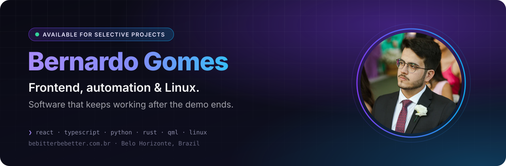
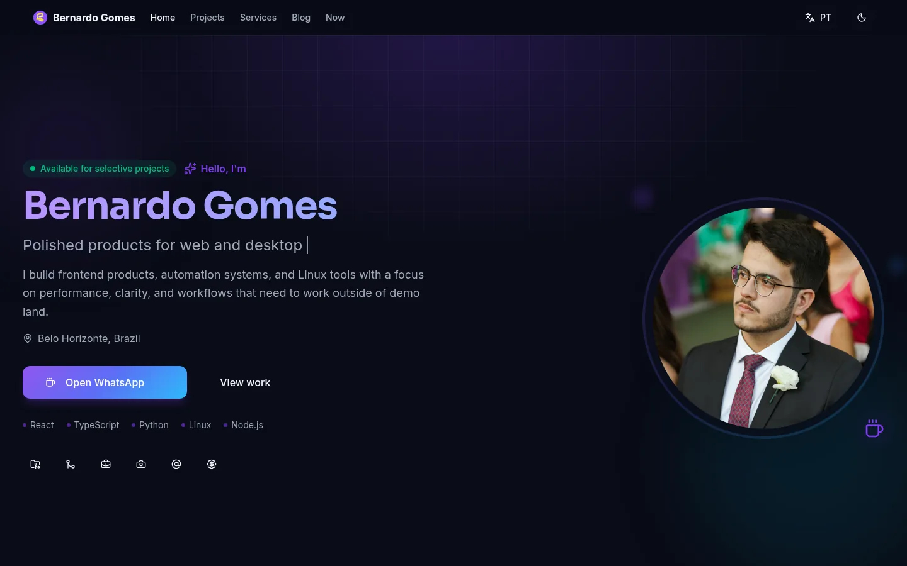
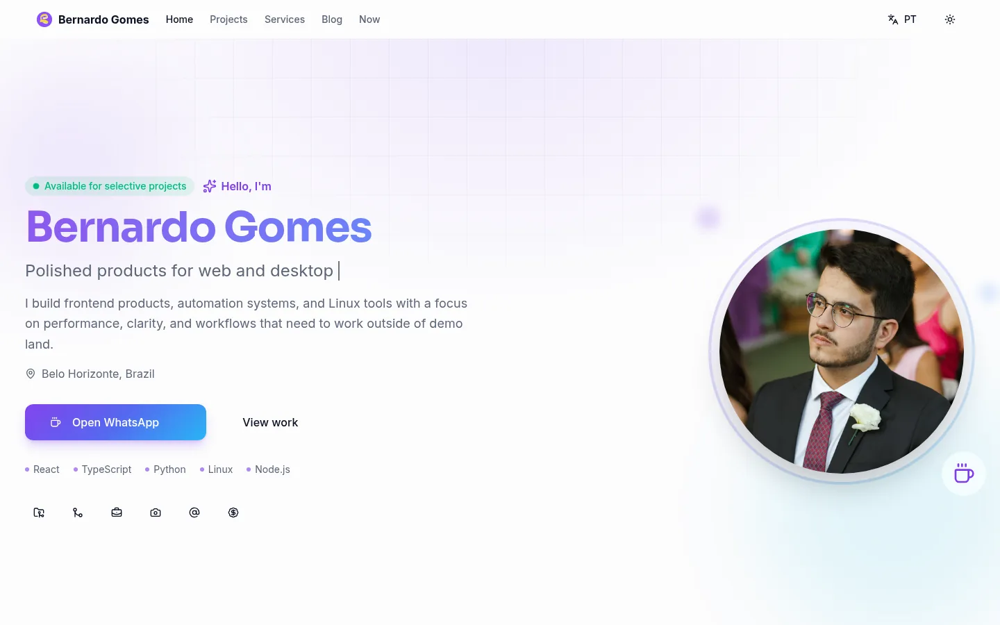
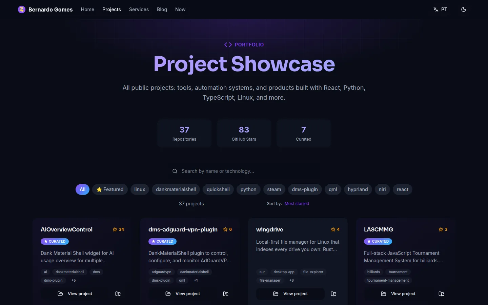
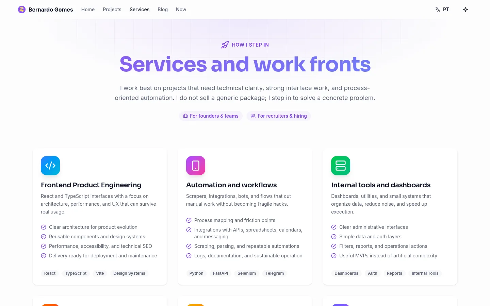
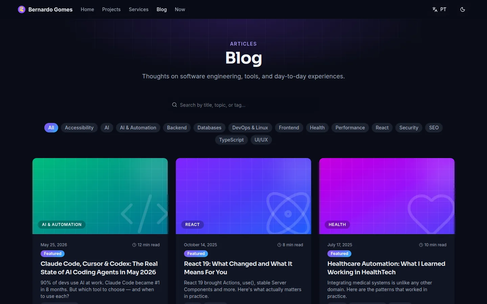
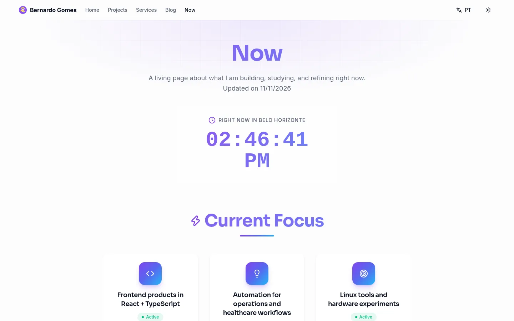
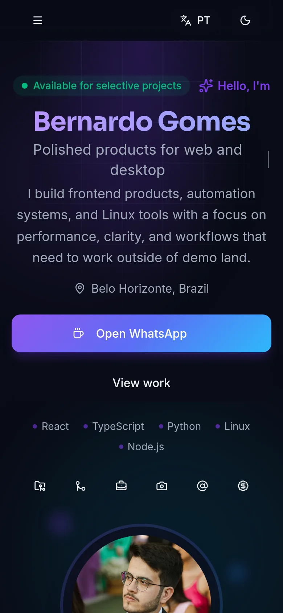
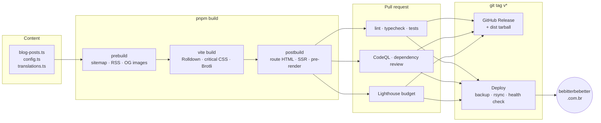

<div align="center">

<a href="https://bebitterbebetter.com.br">
  
</a>

<br />

**[Live site](https://bebitterbebetter.com.br)** ·
**[Projects](https://bebitterbebetter.com.br/projects/)** ·
**[Services](https://bebitterbebetter.com.br/services/)** ·
**[Blog](https://bebitterbebetter.com.br/blog/)** ·
**[Now](https://bebitterbebetter.com.br/now/)** ·
**[Book a call](https://cal.com/bernardopg)**

<br />

[](https://bebitterbebetter.com.br)
[](https://github.com/bernardopg/BeBitter/actions/workflows/ci.yml)
[](https://github.com/bernardopg/BeBitter/actions/workflows/lighthouse.yml)
[](https://github.com/bernardopg/BeBitter/actions/workflows/codeql-eslint-nodejs.yml)
[](https://github.com/bernardopg/BeBitter/releases)

</div>

---

## Hi, I'm Bernardo 👋

I build **frontend products, automation systems, and Linux tools** for workflows that have to work outside of demo land.

Most of my work sits where product engineering meets operations: interfaces people use every day, scrapers and integrations that remove manual work, and desktop tooling that fits how Linux users actually work. I write mostly **React and TypeScript**, and I move into **Python, Rust, QML, and hardware** when the problem needs it.

I'm also a **medical student**. That shapes how I build software: clear flows, attention to operational detail, and respect for the people at the other end of the screen.

> **This repository is my portfolio, and it's also the proof.** The site you'd visit is the same codebase you're reading: pre-rendered, bilingual, accessibility-checked, performance-budgeted, and shipped by a tag-driven pipeline.

<br />

## What I can build for you

| | Capability | What that looks like in practice |
|:-:|---|---|
| 🎨 | **Frontend product engineering** | React + TypeScript apps with clean architecture, design systems, accessibility, and technical SEO, built to keep evolving after launch. |
| ⚙️ | **Automation & integrations** | Scrapers, parsers, bots, and API, calendar, and spreadsheet integrations that replace repetitive work without becoming fragile hacks. |
| 📊 | **Internal tools & dashboards** | Admin interfaces, reports, and lean MVPs that organize data and speed up teams, with no artificial complexity. |
| 🐧 | **Linux-native tooling & hardware** | QML/Quickshell widgets, desktop utilities, Tauri apps, and Arduino-driven devices for daily-use ergonomics. |
| 🩺 | **Healthcare, education & operations** | Software for scheduling, studying, and repetitive human workflows where clarity and reliability matter. |
| 🔧 | **Polish & iteration** | Performance work, bug triage, UX reviews, and SEO for products that are already live. |

**How I work:** understand the context → cut scope to what matters → build for readability and iteration speed → ship, measure, and remove friction.

<br />

## Selected work

<table>
  <tr>
    <td width="50%" valign="top">
      <h3><a href="https://github.com/bernardopg/AiOverviewControl">AiOverviewControl</a></h3>
      <a href="https://github.com/bernardopg/AiOverviewControl"></a>
      <p>Desktop widget for <b>DankMaterialShell</b> that shows quota, billing, and usage for <b>40+ AI providers</b> (Claude, Codex, Copilot, OpenRouter…) at a glance. My most-starred project, built for Hyprland and niri setups.</p>
      <sub><code>QML</code> · <code>Quickshell</code> · <code>Shell</code> · <code>Linux</code></sub>
    </td>
    <td width="50%" valign="top">
      <h3><a href="https://github.com/bernardopg/ioruba">ioruba</a></h3>
      <a href="https://github.com/bernardopg/ioruba"></a>
      <p>A <b>DIY Arduino-driven audio mixer</b>: physical knobs control master, per-application, sink, and source volume on Linux, with a cross-platform desktop app shipped for Linux, Windows, and macOS.</p>
      <sub><code>Tauri 2</code> · <code>Rust</code> · <code>React</code> · <code>TypeScript</code> · <code>Arduino</code></sub>
    </td>
  </tr>
  <tr>
    <td width="50%" valign="top">
      <h3><a href="https://github.com/bernardopg/LASCMMG">LASCMMG</a></h3>
      <a href="https://github.com/bernardopg/LASCMMG"></a>
      <p>Full-stack <b>tournament management system</b> with automatic bracket generation, real-time updates, JWT/CSRF security, Redis caching, and PWA support.</p>
      <sub><code>Node.js</code> · <code>Express</code> · <code>Socket.io</code> · <code>SQLite</code> · <code>React</code></sub>
    </td>
    <td width="50%" valign="top">
      <h3><a href="https://github.com/bernardopg/mvp-estetoscopio">mvp-estetoscopio</a></h3>
      <a href="https://github.com/bernardopg/mvp-estetoscopio"></a>
      <p><b>Flashcard study platform</b> built on the SM-2 spaced-repetition algorithm, designed for medical and law students.</p>
      <sub><code>Next.js</code> · <code>TypeScript</code> · <code>MDX</code> · <code>SQL</code> · <code>Tailwind</code></sub>
    </td>
  </tr>
  <tr>
    <td width="50%" valign="top">
      <h3><a href="https://github.com/bernardopg/cmmg-calendar">cmmg-calendar</a></h3>
      <a href="https://github.com/bernardopg/cmmg-calendar"></a>
      <p>Scrapes a medical school's academic calendar and syncs it to <b>Google Calendar</b> or <b>Apple Calendar</b> via iCalendar, so no class or exam goes missing.</p>
      <sub><code>TypeScript</code> · <code>Python</code> · <code>Scraping</code> · <code>ICS</code></sub>
    </td>
    <td width="50%" valign="top">
      <h3><a href="https://github.com/bernardopg/dms-adguard-vpn-plugin">dms-adguard-vpn-plugin</a></h3>
      <a href="https://github.com/bernardopg/dms-adguard-vpn-plugin"></a>
      <p>Shell plugin to <b>control, configure, and monitor AdGuard VPN</b> from the Linux desktop, without opening a terminal.</p>
      <sub><code>QML</code> · <code>Quickshell</code> · <code>JavaScript</code> · <code>Linux</code></sub>
    </td>
  </tr>
</table>

<p align="center">
  More: <a href="https://github.com/bernardopg/GiftPilot">GiftPilot</a> (Manifest V3 browser extension) ·
  <a href="https://github.com/bernardopg/steam-idler-python">steam-idler-python</a> (Python automation) ·
  <a href="https://bebitterbebetter.com.br/projects/"><b>full showcase →</b></a>
</p>

<br />

## A look at the site

<table>
  <tr>
    <td width="50%"></td>
    <td width="50%"></td>
  </tr>
  <tr>
    <td width="50%"></td>
    <td width="50%"></td>
  </tr>
  <tr>
    <td width="50%"></td>
    <td width="50%"></td>
  </tr>
</table>

<details>
<summary><b>📱 Mobile view</b></summary>
<br />
<p align="center"></p>
</details>

<br />

## Engineering highlights

This is a deliberately small site run with the discipline of a product team.

<table>
  <tr>
    <td width="33%" valign="top">
      <h4>⚡ Performance</h4>
      <ul>
        <li><b>40 routes pre-rendered</b> to static HTML through an SSR build, so content paints before JS boots</li>
        <li>Critical CSS inlined by a custom Vite plugin</li>
        <li>Gzip + Brotli assets, manual vendor chunking, lazy routes</li>
        <li><b>Lighthouse budget gate</b> on every PR (LCP, CLS, TBT, and category scores)</li>
      </ul>
    </td>
    <td width="33%" valign="top">
      <h4>🔍 SEO & content</h4>
      <ul>
        <li>Per-route <b>Open Graph images generated at build time</b></li>
        <li>Sitemap, RSS feed, <code>llms.txt</code>, and JSON-LD structured data</li>
        <li><b>27 technical articles</b> with English and Portuguese titles</li>
        <li>Bilingual UI (EN / PT-BR) with light and dark themes</li>
      </ul>
    </td>
    <td width="33%" valign="top">
      <h4>🛡️ Security & delivery</h4>
      <ul>
        <li>GitHub README HTML <b>sanitized with DOMPurify</b> before rendering</li>
        <li>CodeQL, Dependency Review, Dependabot, and audited <code>pnpm</code> overrides</li>
        <li>HSTS preload and hardened response headers</li>
        <li><b>Tag-driven release and deploy</b> with remote backup and post-deploy checks</li>
      </ul>
    </td>
  </tr>
</table>

### How a release reaches production



<br />

## Tech stack

| Layer | Tools |
|---|---|
| **App** | React 19 · React Router 7 · TypeScript 6 (strict) |
| **UI** | Tailwind CSS 4 · Radix UI · shadcn/ui · Framer Motion · Lucide |
| **Data** | TanStack Query · GitHub REST API · React Context |
| **Forms** | React Hook Form · Zod |
| **Build** | Vite 8 (Rolldown) · SSR pre-render · custom critical-CSS plugin · gzip/Brotli |
| **Quality** | ESLint 10 (flat config, jsx-a11y) · Vitest · Testing Library · Lighthouse |
| **Delivery** | GitHub Actions · CodeQL · Dependabot · SSH + rsync to Hostinger |
| **Runtime** | Node 24 · pnpm 12 |

<br />

## From the blog

I write about the things I ship and the tools I depend on. A few highlights:

- [**Web Performance: From 3s to 0.8s in Practice**](https://bebitterbebetter.com.br/blog/performance-web-3s-para-0-8s)
- [**Healthcare Automation: What I Learned Working in HealthTech**](https://bebitterbebetter.com.br/blog/automacao-saude-o-que-aprendi)
- [**Shai-Hulud: The Worm Still Infecting npm and How to Protect Your Supply Chain**](https://bebitterbebetter.com.br/blog/shai-hulud-npm-worm-defesa-2026)
- [**GitHub Actions and OIDC: Deployments Without Long-Lived Credentials**](https://bebitterbebetter.com.br/blog/github-actions-oidc-deploy-sem-segredos-longos)
- [**Vite 8 and Rolldown: What It's Like to Swap Your Bundler for Rust in Production**](https://bebitterbebetter.com.br/blog/vite-8-rolldown-rust-bundler-2026)

[All articles →](https://bebitterbebetter.com.br/blog/) · [RSS feed](https://bebitterbebetter.com.br/feed.xml)

<br />

## Run it locally

Requires the Node version in [`.node-version`](.node-version) and the pnpm version pinned in [`package.json`](package.json).

```bash
corepack enable
pnpm install --frozen-lockfile
cp .env.example .env.local
pnpm dev                  # http://localhost:8080
```

| Command | What it does |
|---|---|
| `pnpm ci:check` | Lint, typecheck, tests, and production build (mirrors CI) |
| `pnpm build` | Sitemap, RSS, and OG images, then Vite build and pre-render |
| `pnpm test` | Vitest in watch mode |
| `pnpm lighthouse:budget` | Audits `/`, `/blog/`, and `/services/` against the performance budget |
| `pnpm security:audit` | `pnpm audit` at high severity |

> [!IMPORTANT]
> `VITE_*` variables are inlined into the client bundle. Never put secrets in them.

Publishing is tag-driven: pushing a `v*` tag runs the [release](.github/workflows/release.yml) and [deploy](.github/workflows/deploy.yml) workflows. Setup, manual runs, and rollback are covered in [`DEPLOY-CHECKLIST.md`](DEPLOY-CHECKLIST.md).

<details>
<summary><b>Project structure</b></summary>

```text
src/
├── components/   # layout, SEO, analytics, shared UI (shadcn/ui primitives in ui/)
├── constants/    # site config, translations, blog posts
├── contexts/     # language and projects providers
├── hooks/        # GitHub API, animations, utilities
├── pages/        # routes: Index, Projects, Services, Blog, Now
└── utils/        # security, performance, toast helpers
scripts/          # build-time generators, pre-render, deploy, Lighthouse budget
```

</details>

<details>
<summary><b>Further documentation</b></summary>

- [Documentation index](docs/README.md)
- [Architecture and automation](docs/technical-overview.md)
- [Routes and sitemap](docs/routes-and-sitemap.md)
- [Performance strategy](PERFORMANCE-OPTIMIZATION.md)
- [SEO checklist](SEO-CHECKLIST.md)
- [Security policy](SECURITY.md)
- [Scripts](scripts/README.md)
- [Changelog](CHANGELOG.md)

</details>

<br />

## Let's work together

I take on a small number of projects at a time: products that need strong frontend work, automations that must respect a real process, and software that has to survive past the MVP.

<p>
  <a href="https://cal.com/bernardopg"></a>
  <a href="mailto:bernardo.gomes@bebitterbebetter.com.br"></a>
  <a href="https://www.linkedin.com/in/bernardopg/"></a>
  <a href="https://wa.me/5531984916431"></a>
  <a href="https://github.com/sponsors/bernardopg"></a>
</p>

Typical response time: within 24 hours.

---

<div align="center">
  <sub>
    Built and maintained by <a href="https://github.com/bernardopg">Bernardo Gomes</a> in Belo Horizonte, Brazil.<br />
    Released under the <a href="LICENSE.md">MIT License</a>.
  </sub>
</div>
